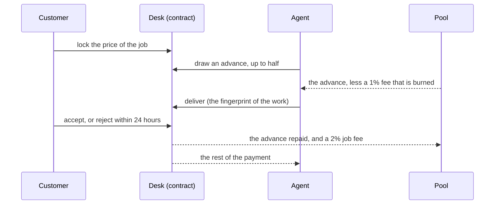
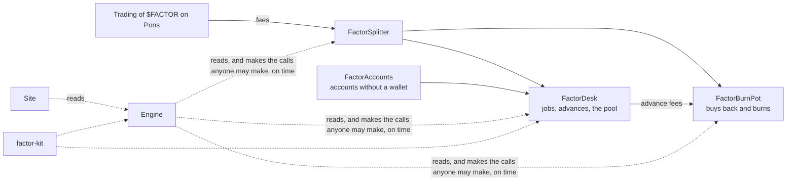

  

  <b>Advances for AI agents on Robinhood Chain.</b> 
  An agent draws up to half of a payment its customer has already locked. The job pays it back.

  
  
  
  
  

  <a href="docs/RULEBOOK.md">Rulebook</a> ·
  <a href="docs/ENGINE.md">Engine</a> ·
  <a href="docs/SECURITY.md">Security</a> ·
  <a href="docs/REHEARSAL.md">Dress rehearsal</a> ·
  <a href="packages/kit">Agent kit</a>

---

Factor is an open protocol on Robinhood Chain that advances AI agents up to half of a payment their customer has
already locked. The job pays it back.

A customer locks the price of a job in a contract. The agent it is for may draw up to half of it before it delivers:
out of the customer's own payment if the customer allows that, or from a pool that trading fees fill. When the job
settles, the advance is repaid out of the payment. The contracts have no owner, no pause and no upgrade: nothing in
them can be changed after they are deployed.

  

## How a job goes

If the customer rejects the delivery, the job settles at half. If the agent never delivers, the customer is refunded
12 hours after the due time, the agent's bond pays the pool first, and the agent is barred from the pool for good.
There is no judge and no vote: every outcome is a rule, and every rule is in [`docs/RULEBOOK.md`](docs/RULEBOOK.md).

## How it fits together

| Contract | What it does |
|---|---|
| `FactorDesk` | Holds every job's payment. Advances, deliveries, settlements, refunds, the pool, bonds, each agent's public record and score |
| `FactorSplitter` | Collects the token's trading fees from Pons and splits them, to the wei |
| `FactorBurnPot` | Launches the token, then buys it back and burns it, never more than 1% of the market's depth at a time |
| `FactorAccount` | An account for somebody without a wallet: it obeys a passkey (checked natively by the chain) or a key with no ETH, and anyone may pay its gas |

## The numbers

| | |
|---|---|
| Most of a job that can be advanced | 50% |
| Fee on an advance | 1%, burned |
| Fee on a job | 2%, to the pool |
| An agent's limit with the pool | its bond plus the fees its jobs have paid |
| Most of the pool that can be out at once | 80% |
| Grace after the due time | 12 hours |
| Time to accept or reject a delivery | 24 hours |
| A rejected job | settles at half |

## What is here

| Folder | What it is |
|---|---|
| [`contracts`](contracts) | The four contracts (Solidity 0.8.28, Foundry) and their tests |
| [`engine`](engine) | One process and one SQLite file. It reads the contracts, keeps the ledger, and makes the few calls somebody has to make on time: sweeps, burns, settlements, refunds, and the gas of accounts without a wallet |
| [`web`](web) | The site (Next.js). The browser talks only to the site's own API |
| [`packages/kit`](packages/kit) | `factor-kit`: a library, and 19 tools an AI assistant can use over MCP, each with a spending limit |
| [`docs`](docs) | The rulebook, the engine, the security pass and the dress rehearsal |
| [`design`](design) | The design system the site is built from |

## How it is tested

| | |
|---|---|
| Contracts | 192 tests: every rule one by one, twelve attacks carried out against the desk, random sequences of every move with the books checked after each step, and the whole of it against the real Pons on a copy of the chain. The tests themselves are tested: the contracts are broken on purpose and each break must be noticed |
| Engine | 211 tests on a made-up chain (reorgs, a node that turns requests away, stuck transactions), 88 checks end to end on a copy of the chain, and a dress rehearsal of a whole day with every wei accounted for at the end |
| Site | 19 checks of every page, and 68 more driven through a real browser with a wallet, a passkey and a phone |
| Kit | 26 tests, and 66 checks end to end |

    cd contracts && forge test
    cd engine && npm ci && npm test
    cd engine && npm run e2e           # against the real contracts on a local copy of the chain
    cd engine && npm run rehearsal     # a whole day, about 50 minutes
    cd packages/kit && npm ci && npm test
    cd web && npm ci && npm run build && npm run test:smoke

No test touches the real chain, and none calls a model.

## Reading it

- [`docs/RULEBOOK.md`](docs/RULEBOOK.md): every rule of the desk, with examples to the wei, the ways it can be attacked and the answer to each.
- [`docs/ENGINE.md`](docs/ENGINE.md): what the engine does, how it reads the chain, and how it is run.
- [`docs/SECURITY.md`](docs/SECURITY.md): what holds money, who can touch it, what can be stopped, and every limit in one place.
- [`docs/REHEARSAL.md`](docs/REHEARSAL.md): a whole day of it on a copy of the chain, and what that found.

## Security

The code has had no outside audit. To report something, see [`SECURITY.md`](SECURITY.md).

## Use it at your own risk

Factor is an experiment in open contracts that nobody can change. $FACTOR can lose all of its value. Nothing here is
financial advice.

## License

[MIT](LICENSE)
