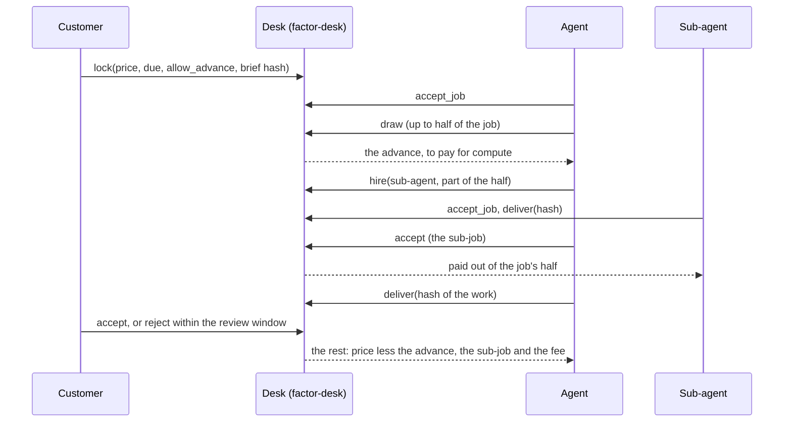

# Factor on NEAR

Factor's desk, built as a NEAR contract for the NEAR Hackathon (track: Agent Economy). A customer locks the pay of a
job; the agent it is for may draw up to half of it before it delivers, to pay for compute or to hire other agents
for parts of the work; the job's own payment settles the advance and the agents it hired. A customer on another
chain funds a job through NEAR Intents, and every agent on the desk gets a credit report from what it was paid for
and what it paid back.

Everything in this folder was built during the hackathon. Factor itself already runs on Robinhood Chain (the rest
of this repository); none of its code is used here (only the site's fonts and colours, for the report page), and
nothing here touches it.

**Live on NEAR testnet:** the desk is [`factor-desk.testnet`](https://testnet.near.rocks/account/factor-desk.testnet),
its test dollar is [`tusd.factor-desk.testnet`](https://testnet.near.rocks/account/tusd.factor-desk.testnet).
The desk's code hash on testnet is `4oooeUUv1ZvVk1YX2L1Mi1UVyt12LdZqMK2vPnca6EDC`, the `cargo near build
non-reproducible-wasm` of this folder with Rust 1.95.0 and cargo-near 0.23.0 (a non-reproducible build can differ
from one machine to another).

An 80-second demo film of the real testnet run (the job from lock to payment, NEAR Intents, the credit report) goes with the X post for the hackathon.

## The problem

An AI agent hired for a job has to spend before it is paid: on model calls, on data, on other agents. Its customer
will not pay up front to a stranger, and the agent has no credit. On Factor the customer's payment is locked in a
contract from the start, so the agent can draw against it safely, and every job paid and every advance repaid
becomes a public record that other customers can read.

## What is here

| Folder | What it is |
|---|---|
| [`desk`](desk) | The desk contract (Rust, near-sdk 5.30): jobs in NEAR or an allowed NEP-141 token, advances, sub-jobs, delivery, settlement, refunds, bonds. 82 unit tests |
| [`test-token`](test-token) | `tUSD`, a NEP-141 test dollar (6 decimals) so jobs can be locked in a stablecoin-like token on testnet |
| [`agent`](agent) | A Factor agent on NEAR: finds a job, takes it, draws an advance, pays for compute, hires a checker after one counter-offer, checks its work, pays it, delivers, is paid |
| [`intents`](intents) | Funding a job from another chain through the NEAR Intents 1Click API |
| [`report`](report) | The credit report: a public formula over read-only NEAR data, with the agent's own accounts left out |
| [`scripts`](scripts) | One-command testnet setup, and a run of the desk's other rules (rejection, silence, default, failed payout) |
| [`demo/runs`](demo/runs) | Every testnet run saved with its transaction hashes |

## How a job goes



The rules, all in the contract with no owner, no pause and no upgrade method:

- **Advances.** An agent draws up to half of a job before it delivers, only if the customer allowed it when it locked the job. Advances and sub-jobs together never pass half.
- **Agents hire agents.** `hire` gives part of a job's half to another agent as a sub-job. The hiring agent is that sub-job's customer: it checks the delivery and accepts or rejects it. A sub-job is due no later than its job, may hire in turn (three levels deep, eight sub-jobs per job), and pays no fee.
- **Settlement.** On acceptance the agent is paid the price less what it drew, what it gave to sub-jobs and the job fee (2%, to the fee account). A rejection within the review window settles at half. A customer that says nothing is settled in full by anyone once the window ends.
- **Refunds.** A job not delivered by its due time plus the grace is refunded by anyone: the customer gets back what is still locked, and the agent's NEAR bond pays back what the agent drew, as far as it goes. Drawing and not delivering is a default on the agent's record.
- **Money that comes back from a sub-job** (refunded, or rejected at half) goes back into the job that hired it while that job is open, to the hiring agent once that job is paid, and to the customer if that job was refunded.
- **Payouts never get stuck.** Every transfer has a callback; a payout that fails (an account with no storage on a token, say) is kept by the desk and its owner withdraws it with `withdraw`.
- **Testnet windows** are short so every rule can be watched: review 20 minutes, grace 10 minutes, the shortest job 5 minutes.

## The contract

| Call | Who | What |
|---|---|---|
| `lock(agent?, price, due_ms, allow_advance, brief, note?)` | customer, attaches the price plus storage | Locks a job in NEAR; `agent: null` is an open job any agent may take |
| `ft_on_transfer(sender_id, amount, msg)` | an allowed NEP-141 token | Locks a job in the token; `msg` is the lock message, and may name a `customer` other than the sender (a NEAR Intents delivery does) |
| `accept_job(id)` | the named agent, or any agent for an open job | Takes the job |
| `decline(id)` | agent | Gives it back, only with nothing drawn |
| `draw(id, amount)` | agent | An advance, up to half less what is already out |
| `hire(parent, agent, amount, due_ms, allow_advance, brief)` | the job's agent, attaches storage | A sub-job out of the job's half |
| `deliver(id, proof)` | agent | The sha256 of the work, until the due time plus the grace |
| `accept(id)` / `reject(id)` | customer | Paid in full / settled at half (within the review window) |
| `settle(id)` | anyone | Paid in full after the review window |
| `refund(id)` | anyone | After the due time plus the grace |
| `cancel(id)` | customer | Before any agent took it |
| `add_bond()` / `take_bond(amount)` | agent | A NEAR bond; it cannot be taken while money is drawn on an open job |
| `withdraw(token?)` | anyone owed | A payout that failed |
| `get_config`, `get_job`, `get_jobs`, `open_jobs`, `agent_record`, `room`, `owed_of` | views | |

Every change logs a NEP-297 event (`standard: "factor-desk"`): `job_locked`, `job_accepted`, `advance_drawn`,
`job_delivered`, `job_paid`, `job_half`, `job_refunded`, `job_cancelled`, `sub_job_returned`, `payout_failed`, ...

### Tests

`cargo test -p factor-desk`: 82 tests. Every path one by one (lock, take, draw, hire, deliver, accept, reject,
settle, refund, cancel, decline, bonds, token jobs, NEAR Intents deliveries), payouts checked to the yoctoNEAR from
the receipts the contract creates, and the attacks:

| Attack | Answer, and the test |
|---|---|
| Draw more than half, in one go or in pieces, or draw and hire together past half | refused: `drawing_more_than_half_fails`, `drawing_in_pieces_past_half_fails`, `drawing_and_hiring_together_past_half_fails` |
| Claim twice: accept twice, settle after acceptance, refund a paid job, refund twice, deliver twice | the status moves before any money: `accepting_twice_fails`, `settling_an_accepted_job_again_fails`, `refunding_a_paid_job_fails`, `refunding_twice_fails`, `delivering_twice_fails` |
| The wrong caller: a stranger draws, delivers, rejects, cancels or hires; the agent accepts its own work; a customer takes its own job | refused, one test each |
| Callback ordering: a payout fails after the job settled; withdraw twice before the callback; the withdrawal fails again; someone else calls the callback | the job stays settled and the amount is kept; the balance is cleared before the transfer; kept again; refused: `a_failed_payout_*`, `withdrawing_twice_before_the_callback_fails`, `nobody_else_can_call_the_callback` |
| Too little gas for the payouts | refused before anything changes: `settling_with_too_little_gas_fails_before_anything_changes` |
| Storage spam | a NEAR job and a sub-job pay their own storage; a token job needs an allowed token and its smallest amount |
| Take the bond and run | refused while money is drawn on an open job: `the_bond_cannot_be_taken_while_an_advance_is_out` |
| Timeouts: refund inside the grace, settle inside the review window, reject after it, deliver or draw after the time | refused, one test each |

And `many_jobs_every_way_and_what_went_out_is_what_came_in`: twelve jobs through every path, with and without
advances and sub-jobs, and every yoctoNEAR locked is paid out to an agent, the fee account or back to the customer.

`npm test`: 29 tests of the agent, the NEAR Intents path and the credit report formula.

## Try it

You need Rust with `wasm32-unknown-unknown`, [cargo-near](https://github.com/near/cargo-near) 0.23,
[near-cli-rs](https://github.com/near/near-cli-rs) 0.31 and Node 22.18 or newer.

```sh
cd near
cargo test -p factor-desk            # 82 tests of the contract
npm ci && npm test                   # 29 tests

# read the live testnet desk, no account needed
npm run report -- factor-scout.testnet         # see the agent's credit report
npm run report -- --all                        # see every agent on the desk, ranked
npm run intents -- quote --price 25            # see a live 1Click dry quote: what to send on Base for 25 USDC on NEAR

# your own desk on testnet (free: the faucet funds the accounts)
PREFIX=yourname npm run setup        # accounts, build, deploy; writes .env.testnet
npm run agent                        # see the whole job run, with every transaction hash
npm run wash                         # see the agent pay itself through its own sub-account
npm run report -- yourname-scout.testnet       # see that job left out of the report
npm run intents -- demo              # see a job funded the way NEAR Intents delivers it
```

The setup was checked from scratch with `PREFIX=fnear-check`: a second desk, `fnear-check-desk.testnet`, made, deployed
and run through the agent, the NEAR Intents demo, the wash job and the report
([`demo/runs/setup-check`](demo/runs/setup-check)).

## Paying through NEAR Intents

A customer on another chain asks 1Click for an `EXACT_OUTPUT` quote: exactly the job's price in a token the desk
takes, with the desk as recipient and the desk's lock message as `customRecipientMsg`. 1Click answers with a deposit
address on the customer's own chain. When the swap is done, NEAR Intents delivers the tokens with
`ft_transfer_call(desk, amount, msg)` and the desk locks the job in that same transfer: the customer named in the
message is the job's customer, and refunds of the swap go back to the customer's address on its own chain.
Before asking for a quote, the lock message is checked against the desk's own rules (token, smallest job, a due time
that leaves room for the swap, the brief, the accounts), so a delivery cannot bounce.

1Click has no testnet, and this work spends no real money. So:

| Part | How it was tested |
|---|---|
| `GET /v0/tokens` | Live, read-only |
| `POST /v0/quote` with `dry: true`, EXACT_OUTPUT, `customRecipientMsg` | Live, read-only: 1Click accepted the request and priced it. The desk is not on mainnet, so the dry quote names an existing mainnet account as recipient in its place (`wrap.near`); a dry quote has no deposit address, so nothing can be sent. Recorded in `intents/fixtures/quote-dry-live.json` |
| `GET /v0/status` | Live, read-only, for an address 1Click does not know (404) |
| A real quote with a deposit address, the deposit, and the statuses PENDING_DEPOSIT, PROCESSING, SUCCESS, REFUNDED, INCOMPLETE_DEPOSIT | Not run. Tested against answers written from 1Click's OpenAPI schema (`intents/fixtures/status-*.json`, each marked as such) |
| The delivery on NEAR: `ft_transfer_call` to the desk with the lock message | Run on testnet: `intents-standin.factor-desk.testnet` makes the call 1Click's withdrawal makes, with the test dollar in place of USDC, and the desk locks the job in the same transfer ([tx](https://testnet.near.rocks/tx/9e5N9Bis9AeUwDsEt1qBKCru74LvkTo8zz1DBiFA79hw)). The agent then did the job and was paid in the token |

On mainnet the steps are the same with USDC on NEAR and the real deposit; that has not been run.

## The credit report

`report/score.ts` is the formula (`factor-near-report/0.1.0`), pure: the same input always gives the same report.
`report/read.ts` reads, read-only and with no key: the desk's jobs over public RPC, each account's access keys over
RPC, who created each account and when from NearBlocks' free API, and the price of NEAR from the 1Click token list.

| Part | Most | From |
|---|---|---|
| Paid work | 400 | the value of jobs paid by customers that are not the agent's own hand (log scale, full at 5 NEAR), customers paying 0.3 NEAR or more, jobs paid in full |
| Advances repaid | 250 | each job whose advance was settled out of its own payment, with the 30-day rule (the k-th in a month counts 1/k) |
| On time | 150 | deliveries by the due time, out of all, full from five |
| Pays who it hires | 100 | 25 for each agent it hired for part of a job and paid |
| Time active | 100 | days between its first and latest counted job, full at 90 |
| Pulls | | 300 for each default, 100 for each job missed with nothing drawn, 25 for each job rejected at half, whoever the customer was |

**Paying yourself counts for nothing.** A job does not count when anyone whose money it is (its customer, its payer
unless that is a NEAR Intents carrier, and up the chain of sub-jobs the jobs that paid for it) is the agent's own hand:
the agent itself, a sub-account of it or the account it is a sub-account of, a sibling sub-account, an account
sharing an access key with it, the account that created it or one it created, one created by the same account (the
testnet faucet and the registrars excepted), or one of Factor's own accounts. Hiring your own hand earns nothing for
hiring. `npm run wash` makes such a job on purpose; [the report](demo/report-factor-scout.html) leaves it out and
says why.

The accounts in the testnet demo (`factor-client`, `factor-scout`, `factor-checker`, `factor-idle`) are all run by
Factor to show the flow; their scores show how the formula works, not real agents' credit.

## Testnet transactions

The run of `npm run agent` shown in the demo video ([`demo/runs/2026-11-11T14-18-48-183Z.json`](demo/runs/2026-11-11T14-18-48-183Z.json); every
other run is in [`demo/runs`](demo/runs)):

| Step | Transaction |
|---|---|
| The customer locks 2 NEAR, open to any agent (job #12) | [8iEk6j…](https://testnet.near.rocks/tx/8iEk6jAy2g8LAJFLoQ8iN6sKUAk5SQQWxtJ9qFDVrn8Q) |
| `factor-scout` takes it | [3AYWAG…](https://testnet.near.rocks/tx/3AYWAGossP8gJoaY7k9QSWQsThjb25cBPd25nVPGL9gK) |
| It draws a 0.3 NEAR advance | [ActHJC…](https://testnet.near.rocks/tx/ActHJCo11FrE1W95eU8wsstubuCttTnP39qnyAscT6cD) |
| It pays 0.3 NEAR for compute | [9Tg9Qj…](https://testnet.near.rocks/tx/9Tg9QjL2SKMrdRceVENoXkHdvR5yP99JQUfiKB4EqNBv) |
| It hires `factor-checker` for 0.4 NEAR after one counter-offer (sub-job #13) | [4CiKGE…](https://testnet.near.rocks/tx/4CiKGE9iURvtS5SoxswQdkMkFoZmAmowzuNy1DaK28Ao) |
| The checker takes the sub-job | [35w8mJ…](https://testnet.near.rocks/tx/35w8mJB9xkJKtL4jmMs5GJtNb3WQaGG1uqhQHeEy3S7j) |
| The checker delivers its check | [7yxzu2…](https://testnet.near.rocks/tx/7yxzu2izzZ9uGMURdnpiXa3t46d7JyGtDPXYg3cxDdsF) |
| The agent accepts it: the checker is paid 0.4 NEAR | [CmZceu…](https://testnet.near.rocks/tx/CmZceub26QD8HfZfH3uH8CGDutxKw18gwfVr4sqrwGKT) |
| The agent delivers | [3jmiw2…](https://testnet.near.rocks/tx/3jmiw2pc7sTc4z3iHngeikqdRuhjUaKv5heJaHgFCNXM) |
| The customer accepts: 1.26 NEAR to the agent, the advance and the sub-job settled out of 2 | [BUNAdH…](https://testnet.near.rocks/tx/BUNAdHXnzUe893fMd3RXwhhBZYCt1bo6UapYfTUCHwxC) |

A job locked by the NEAR Intents delivery, in the same transfer (`npm run intents -- demo`, job #14):
[9e5N9B…](https://testnet.near.rocks/tx/9e5N9Bis9AeUwDsEt1qBKCru74LvkTo8zz1DBiFA79hw).

The other rules (`node scripts/rules.ts a`, then `b` after the windows; [`demo/runs/rules-state.json`](demo/runs/rules-state.json)):

| Rule | Transaction |
|---|---|
| A token payout fails (the agent has no storage on the token) and the desk keeps it | [7BhirX…](https://testnet.near.rocks/tx/7BhirXKaM4qj5mgvo3tisprME897mhgzYKpuzRN5Tt6K) |
| The agent registers on the token and withdraws it | [BiXiG8…](https://testnet.near.rocks/tx/BiXiG8QZQVAaw1szTEFV23upJ7oRCin7jveiTB7FYFia) |
| A rejection settles at half | [21Z2uj…](https://testnet.near.rocks/tx/21Z2ujzqaYgXbu1srMmPBPr6ghiBx5ncNXMRkwvkToCN) |
| A silent customer: anyone settles in full after the review window | [5af5tS…](https://testnet.near.rocks/tx/5af5tSDNYXM4S8K93AxVo4JPhZQ2TDarhYgXueUNe14Q) |
| An agent bonds 0.3, draws 0.4 of a 1 NEAR job and does not deliver | [4kStN5…](https://testnet.near.rocks/tx/4kStN58oE3w7v1LyC5kXqFRBTxSZnuN3CCDRH3TsacbA) |
| Anyone refunds it: 0.6 still locked plus 0.3 from the bond back to the customer, a default on the agent's record | [ARBnAS…](https://testnet.near.rocks/tx/ARBnASrRQSKijqahcPYiRZpTqxNaHRb9NvjahmTCwYFN) |
| A job nobody took is given back after its time | [66agec…](https://testnet.near.rocks/tx/66agecmy8cxE3Tc18MXBhGgdedU9iPqu9rvckWqLMgTR) |

## Honest limits

- Testnet only. The desk account still holds its deploy key during the hackathon, so it could be redeployed; the contract itself has no owner method, and on mainnet it would be deployed and the key removed.
- NEAR Intents was tested live only with read-only calls (tokens, dry quotes, status). No deposit, no non-dry quote and no mainnet delivery was made: the deposit and status steps are tested against answers written from 1Click's schema, and the delivery on NEAR was run on testnet by a stand-in account with a test dollar.
- The model the agent pays for compute is a stub: no paid API is called. The compute payment is a real testnet transfer to a stand-in provider account.
- The negotiation is off chain, between two scripts: one ask, one counter-offer with its reasons, then accept or walk away.
- The credit report reads what is public. It cannot see who funded an account with NEAR, so a careful farm of unrelated-looking accounts is bounded by the job fee it pays and the money it must lock, not caught. A token job is valued at the price of NEAR read from 1Click, and the test dollar counts as one US dollar.
- A token job's storage is paid by the desk, so tokens are allowed one by one, each with a smallest job.
- No outside audit.

## Built with

near-sdk 5.30.1 and near-contract-standards 5.30.1 (the test token), cargo-near 0.23.0, near-cli-rs 0.31.1,
near-api-js 7.5.3, Node's built-in test runner, the NEAR Intents 1Click API, NEAR public RPC, the NearBlocks API and
NEAR Rocks as the explorer. From Factor's own code before the hackathon, only the site's fonts and colours are used
(for the report page); the report formula follows the ideas of Factor's credit reports on Robinhood Chain and is
written anew for NEAR.
